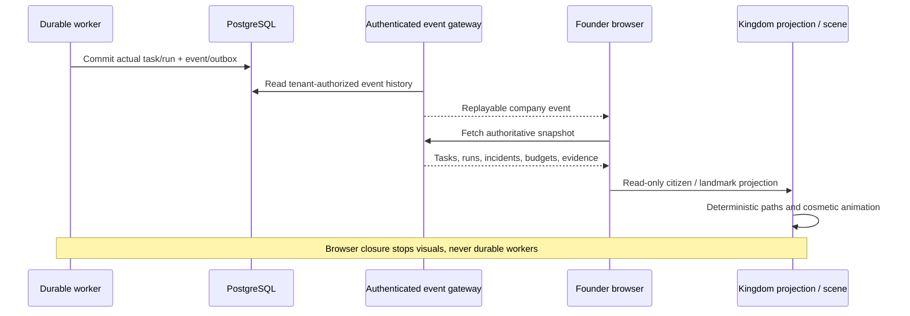

# Kingdom Edition v2 — world contract and acceptance

The founder supplied the complete v2 design on 20 October 2026. Their direct request preserves the original Office as a separate version; Kingdom is the new default at `/` or `/kingdom`, and legacy Office remains at `/office`. Kingdom has no office floors or tower cutaways. ADR 002 records this deliberate scope precedence.

## Data boundary

The existing authenticated FastAPI snapshot and replayable event connection remain authoritative. The world receives the same tenant-scoped snapshot as every management screen. Backend jobs, budgets, integrations, independent Watchtower, approvals and email are unchanged. No provider connection is simulated to animate the island.

`WORLD_VERSION` and the landmark registry are versioned source. Every persisted role maps to a stable citizen ID formed from organization ID and role ID, independent of display name or list order. These are persistent configured citizen identities, not a claim that a paid process runs continuously. The deterministic seed supplies avatar palette, outfit and home/position. A later dedicated agent-instance/profile table can extend this without replacing role IDs.

| Visual field | Source |
|---|---|
| citizen_id | Organization + persisted role ID |
| role / mission / ceilings | Existing role configuration |
| avatar skin / home | Deterministic identity seed and role-to-landmark registry |
| execution state / task_id / run_id | Actual task/run records; active work requires a matching running task and run |
| destination | State + role mapping; approval → post, quarantine → lighthouse |
| world position / local motion | Seeded visual profile and client interpolation on a baked connected street graph; cosmetic, not persisted execution telemetry |
| last server evidence | Linked event time or run creation time; absent evidence remains unknown |
| monitor health | Independent Watchtower heartbeat, separately from incident severity |
| beacon | Actual open incidents only; calm / advisory / critical |

Idle strolls/breathing never invoke a model. Quarantined/blocked/failed states do not animate as working. Waiting-for-approval mail markers require a real linked waiting task. No completed coding/deployment celebration is invented. Losing connection labels the last known state and stops active-work animation. Reduced motion removes waves/gait/pulsing and snaps destination changes.

## Landmarks and real dashboards

Royal Keep → Overview + Settings/STOP ALL + Approvals. Guild → Tasks. Workshop → Build Inspector. Atelier → Agents/design roles. Alchemy → Build Inspector/test evidence. Market → Opportunities/Product Incubator/Portfolio. Treasury → Finance. Lighthouse → Watchtower. Library → Audit/decision history. Post → Founder Inbox. Shipyard → Build Inspector/release evidence. Commons → Projects. Inspectors show actual linked task, run, incident, budget or message data, with a button to open the full existing dashboard. The current library is an evidence/audit entry point, not a newly implemented semantic knowledge-search service.

## Original art and reliability

Original Blender sources and a reproducible generator are under `assets/kingdom/`; self-contained GLB packs are under `apps/web/public/kingdom/`. Twelve functional landmarks, cottages, foliage, gardens, coast, pier and boat occupy one continuous island. Three model-quality tiers, instanced citizens, static contact shadows, bounded orthographic controls, presets, follow/reset, optional labels, reduced motion and a keyboard-accessible landmark/citizen directory are implemented. A WebGL/asset error exposes the operational map rather than granting any new authority. Both production Dockerfiles copy the public assets alongside standalone Next output.

## Verification scope

Unit tests check stable scoped identities, authentic running-task/run pairs, approval/quarantine projection, incident severity, registry destinations and deterministic route connectivity. Asset validation checks GLB structure, twelve landmark identities, named villager parts, no external dependencies and ordered LOD triangle budgets.

The browser acceptance uses real authenticated services, actual existing records, landmark/citizen navigation, camera controls, fallback, a zero-cost internal task event, persisted reload and legacy Office/mobile checks. Its internal task is cancelled afterward. It never fabricates a running agent or incident. A new live hosted-coding animation cannot be certified while Daytona/public gateway remain disconnected; existing model advisory history is shown honestly. Software Chromium render observations and a recorded walkthrough are evidence of interaction, not hardware GPU, load-test or artistic production sign-off.

Original software-renderer measurement: balanced, 25 citizens, 200 draw calls, 208,529 triangles, ~44.7 MB JS heap; warmed RAF ~1.66 FPS on ANGLE/SwiftShader. This does **not** establish production frame-budget compliance. Hardware/mobile testing, full collision/navigation stress, richer choreography/foliage and formal accessibility/art review remain pending. See `docs/evidence/kingdom-performance.json`. The 40-second walkthrough is an actual interaction excerpt accelerated 3×.

Native standalone packaging was also checked after a full production build: copy `apps/web/public` to `apps/web/.next/standalone/apps/web/public` and `.next/static` to the corresponding standalone `.next/static`, then run the standalone `server.js` on an isolated loopback port. Actual HTTP/proxy/checksum results are in `docs/evidence/kingdom-standalone.json`. The production Dockerfiles perform these public/static copies. No Docker/Render deployment is implied by this local process check.

## Island-first interface

The canvas fills the viewport. Floating system-style glass navigation and a compact operational inspector keep the island central. Search finds real landmarks and configured citizens; Enter selects the first match and Escape closes search or restores Focus. Focus hides navigation, inspector and metric HUD, while safety notices remain visible. Buildings opens the landmark directory; Display controls quality and reduced motion. On mobile, selecting a landmark/citizen opens a dismissible inspector sheet; Overview returns to kingdom metrics. The accessible view and preserved Office remain available.

Repeated notification notices are coalesced for readable activity, with source timestamps and occurrence counts. Security incidents remain individually visible; no event records are removed. Latest real browser evidence: `docs/evidence/kingdom-apple-browser.json`; wide and mobile screenshots use the `kingdom-apple-` prefix. This interface change does not resolve the measured software-renderer performance limitation above.

## Reproducible local profiling

Run `python scripts/profile_kingdom_browser.py --name unique-run-name` against the existing local web/API and ignored owner credentials. Defaults: balanced, 1440×1000 at DPR 1, six-second warmup, twelve-second RAF sample. Evidence names cannot overwrite existing captures; source/asset hashes, actual renderer, build mode, quality and units are recorded. The screenshot is captured afterward with reduced motion, so it is not proof of a frozen-time animation comparison. Software timing is not hardware/GPU certification.

The first bounded material experiment failed its 20% target: median 799.9 → 766.6ms (4.16%), with p95 866.7 → 966.7ms. The candidate was rejected and reverted; no visual change was deployed. See `docs/evidence/kingdom-performance-comparison.json` and the exact non-active candidate patch. Further investigation needs a new bounded measurement contract rather than claiming this sample fixed performance.

## Measuring on the founder's device

Open **Display → Measure performance (10s)**, keep the tab visible and view unchanged, then **Download performance report**. The action is entirely in the browser and invokes no agent or provider. Reduced motion must be off; unready/error/2D scenes cannot start. Changing quality, camera preset, motion, canvas size or tab visibility cancels/invalidates a sample. Browser callbacks and actual Three scene-render counts are separate fields so a stalled scene cannot be labeled 60 FPS because browser callbacks continue. The report is a short observation, not GPU timings, controlled hardware evidence or certification; it contains no task/message content, account identity or credentials.

A separate no-blur/opaque-panel software experiment also failed (median 766.7 → 849.9ms, p95 866.6 → 999.9ms) and was reverted. Both failed experiments remain evidence, not active rendering changes. The new diagnostic export enables collection on real founder devices while preserving accepted graphics.
