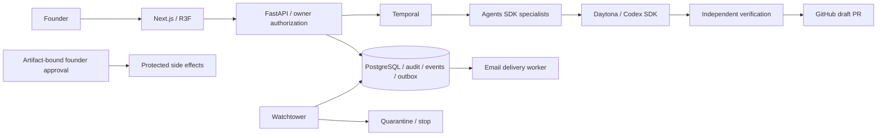

# ADR 001: Persistent modular monolith and isolated execution
Accepted 2026-10-20. FastAPI owns tenant authorization, events, audit, budgets and policy. PostgreSQL transactions serialize budget and aggregate mutations. Temporal owns durable waits/retries and scheduled delivery. Workers receive identifiers and retrieve scoped data, never broad application secrets. Watchtower is a separate service with a stop-only role. Web rendering consumes snapshots and authenticated replayable events; it never invents agent activity. Provider integrations fail closed when missing or unauthorized. Hosted sandbox execution is distinct from host development and test doubles.

